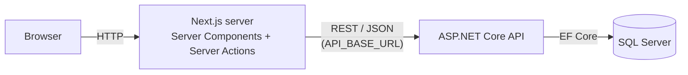
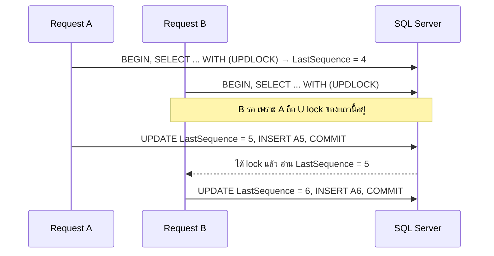

# ระบบบัตรคิว (โจทย์ IT 05): Design & Implementation Plan

เอกสารนี้คือแผนทั้งหมดตั้งแต่ต้นจนจบของโจทย์ข้อ 5: สิ่งที่โจทย์ต้องการ, ข้อสมมติ, การออกแบบ และขั้นตอนทำทีละ step

## 0. วิธีทำงานร่วมกัน

| ใคร | ทำอะไร |
|---|---|
| **คุณ** | รันคำสั่ง init / scaffold / ติดตั้ง package / migration / test, review โค้ด, commit |
| **Claude** | เขียนและแก้โค้ดตาม step ที่สั่ง, อธิบายเหตุผล, แก้ตาม review |

- ทำทีละ step ตามลำดับ สั่งด้วยข้อความเช่น **"ทำ Step 2"**
- ทุก step มี: เป้าหมาย → คำสั่งที่คุณรัน → ไฟล์ที่ Claude เขียน → เกณฑ์ว่าเสร็จ (Definition of Done) → ข้อความ commit ที่แนะนำ
- ข้อความ commit ใช้รูปแบบ [Conventional Commits](https://www.conventionalcommits.org/) เพื่อให้ประวัติอ่านง่าย (รายละเอียดใน 0.1)
- คำสั่งในเอกสารเขียนสำหรับ PowerShell บน Windows

### 0.1 รูปแบบข้อความ commit

ใช้ [Conventional Commits 1.0](https://www.conventionalcommits.org/) และเขียนเป็นภาษาอังกฤษ

```
<type>(<scope>): <subject>

<body>      ← ไม่บังคับ: อธิบายว่าทำไม
<footer>    ← ไม่บังคับ: BREAKING CHANGE, Refs
```

**type**

| type | ใช้เมื่อ | ตัวอย่าง |
|---|---|---|
| `feat` | เพิ่มความสามารถใหม่ที่ผู้ใช้หรือผู้เรียก API มองเห็น | `feat(api): expose queue endpoints` |
| `fix` | แก้ bug | `fix(api): return 409 instead of 500 when queue is full` |
| `refactor` | ปรับโค้ดโดยพฤติกรรมไม่เปลี่ยน | `refactor(domain): extract code formatting into TicketNumber` |
| `perf` | ทำให้เร็วขึ้นโดยพฤติกรรมไม่เปลี่ยน | `perf(infrastructure): issue ticket in a single UPDATE…OUTPUT` |
| `test` | เพิ่มหรือแก้เฉพาะ test | `test(domain): cover sequence boundaries 0, 9, 10 and 259` |
| `docs` | แก้เอกสารอย่างเดียว | `docs: explain locking strategy in README` |
| `build` | ระบบ build, dependency, Docker | `build(backend): bump EF Core to 10.0.16` |
| `ci` | pipeline CI | `ci: run unit tests on push` |
| `chore` | งานดูแลอื่นที่ไม่แตะโค้ดหรือ test เช่น scaffold, config | `chore: initialize repository` |
| `style` | จัดรูปแบบอย่างเดียว ความหมายของโค้ดไม่เปลี่ยน | `style(frontend): apply lint autofix` |

**scope** (ไม่บังคับ ใส่เมื่อ commit แตะส่วนเดียว)

| scope | ครอบคลุม |
|---|---|
| `domain` / `application` / `infrastructure` / `api` | layer ของ backend (migration นับเป็น `infrastructure`) |
| `backend` | ระดับ solution เช่น `Directory.Build.props`, `global.json` หรือแตะหลาย layer พร้อมกัน |
| `frontend` | แอป Next.js |
| `e2e` | Playwright test |
| `docker` | Dockerfile, docker-compose |

ถ้าแตะทั้ง repo หรือหลายส่วนพร้อมกัน ไม่ต้องใส่ scope เช่น `docs: add README`

**header (บรรทัดแรก)**
- ขึ้นต้นด้วยคำกริยารูปคำสั่ง เช่น `add`, `fix`, `remove` ไม่ใช่ `added` / `adds` / `adding` ทดสอบได้ด้วยประโยค *"If applied, this commit will ___"*
- subject ขึ้นต้นตัวพิมพ์เล็ก ไม่มีจุดท้าย
- ทั้งบรรทัดไม่เกิน 72 ตัวอักษร ถ้าได้ไม่เกิน 50 ยิ่งดี

**body** (ใส่เมื่อเหตุผลไม่ชัดจาก header)
- เว้น 1 บรรทัดหลัง header และตัดบรรทัดที่ 72 ตัวอักษร
- อธิบายว่า *ทำไม* และ *มีผลกระทบอะไร* ส่วน *ทำอย่างไร* ให้โค้ดบอกเอง

**footer**
- `BREAKING CHANGE: <คำอธิบาย>` หรือใส่ `!` หลัง type/scope (เช่น `feat(api)!: ...`) เมื่อเปลี่ยน API contract แบบที่ใช้กับของเดิมไม่ได้
- `Refs: #12` เมื่ออ้างถึง issue

**ขนาดของ commit**
- 1 commit = 1 เรื่อง และทุก commit ต้อง build ผ่านและ test ผ่าน
- แยกการย้ายหรือเปลี่ยนชื่อไฟล์ออกจากการแก้เนื้อหา เพื่อให้ diff อ่านง่าย

ตัวอย่างที่มี body:
```
feat(infrastructure): add EF Core persistence with row-locked counter

Read the singleton QueueStates row WITH (UPDLOCK, ROWLOCK) inside a
transaction so concurrent requests wait in line instead of reading the
same LastSequence. A unique index on (Round, Sequence) stays as a
safety net if the lock is ever bypassed.
```

ตัวอย่างที่ไม่ควรใช้: `update`, `fix bug`, `wip`, `Added files.`, `feat: stuff`

---

## 1. สรุปโจทย์

| หน้า | สิ่งที่ต้องทำ |
|---|---|
| **IT 05-1** รับบัตรคิว | ปุ่มใหญ่ "รับบัตรคิว" → ออกเลขคิวถัดไปแล้วไปหน้า IT 05-2 / ปุ่ม "ล้างคิว" → ไปหน้า IT 05-3 |
| **IT 05-2** หมายเลขคิว | แสดงเลขคิว (เช่น `A5`) + `วันที่ : 15/10/2021 เวลา 14:00 น.` / ปุ่ม "กลับไปหน้ารับบัตรคิว" |
| **IT 05-3** ล้างคิว | ปุ่ม "ล้างคิว" + "หมายเลขคิวปัจจุบัน" / กดล้างแล้วแสดง `00` / ปุ่ม "กลับไปหน้ารับบัตรคิว" |

กฎ:
- เลขคิววิ่งจาก `A0` ถึง `Z9` เช่น ถ้าล่าสุดคือ `A9` ใบถัดไปต้องเป็น `B0`
- **ต้องป้องกันการกดรับบัตรคิวพร้อมกัน** (หัวใจของโจทย์ข้อนี้)
- โครงสร้างฐานข้อมูลออกแบบเอง

## 2. ข้อสมมติ (จุดที่โจทย์ไม่ได้ระบุ)

ทุกข้อจะเขียนลง README ตอนส่งด้วย

| # | ข้อสมมติ | เหตุผล |
|---|---|---|
| A1 | ลำดับคือ `A0…A9, B0…B9, …, Z0…Z9` = 260 ใบ (sequence 0–259) | ตรงกับตัวอย่าง A9 → B0 |
| A2 | ออกครบ `Z9` แล้ว **ไม่วนกลับ** API ตอบ `409 Conflict` และหน้าจอบอกให้ล้างคิว | ถ้าวนกลับเอง เลขจะซ้ำในรอบเดียวกัน ซึ่งทำให้เรียกคิวผิดคน |
| A3 | ระบบเริ่มต้นและหลังล้างคิวแสดง `00` ใบถัดไปคือ `A0` | ตาม IT 05-3 |
| A4 | ล้างคิว **ไม่ลบประวัติบัตร** แต่เริ่ม "รอบ" (Round) ใหม่ | เก็บข้อมูลไว้ตรวจสอบย้อนหลังได้ |
| A5 | วันที่ใช้ ค.ศ. รูปแบบ `dd/MM/yyyy HH:mm` เขตเวลา Asia/Bangkok, ฐานข้อมูลเก็บเป็นเวลา UTC พร้อม offset | mockup ใช้ 15/10/2021 ซึ่งเป็น ค.ศ. |
| A6 | "หมายเลขคิวปัจจุบัน" ใน IT 05-3 = เลขของบัตรใบล่าสุดที่ออกในรอบนี้ | ตาม mockup ที่ IT 05-2 และ 05-3 แสดง A5 ตรงกัน |
| A7 | ไม่มีระบบ login (ใช้เป็นตู้กดบัตรคิว) | โจทย์ไม่ได้ระบุ |
| A8 | กด "ล้างคิว" แล้วล้างทันที ไม่มีกล่องยืนยัน | ทำตาม flow ในโจทย์ ระบุใน README ว่าเพิ่มได้ |

---

## 3. Tech stack

| ส่วน | เทคโนโลยี | หมายเหตุ |
|---|---|---|
| Frontend | Next.js 16 (App Router) + TypeScript + Tailwind CSS | Node 26 (มีในเครื่องแล้ว) |
| Backend | ASP.NET Core Web API บน **.NET 10 (LTS)**, Controllers | ดูหมายเหตุเรื่องเวอร์ชันด้านล่าง |
| ORM | EF Core 10 + SQL Server provider + Migrations | |
| Database | **SQL Server 2022 Developer บน Docker** (`2022-CU28-ubuntu-22.04`) ใช้ทั้งตอนพัฒนา, E2E และ Step 9 | เปลี่ยนจาก LocalDB เมื่อ 18 พ.ย. 2026 |
| API docs | OpenAPI ที่มากับ ASP.NET Core + Scalar UI | เปิดดูได้ที่ `/scalar` |
| Tests | xUnit (unit), Playwright (E2E ทั้งหน้าจอและ API) | |

### สภาพเครื่อง (ตรวจล่าสุด 16 พ.ย. 2026)

| เครื่องมือ | เวอร์ชันที่มี | สถานะ |
|---|---|---|
| .NET SDK | 10.0.404 (มี 8.0.204 อยู่ด้วย) | ✅ `global.json` จะล็อกให้ใช้ 10 |
| Node.js / npm | 26.13.1 / 11.20.0 | ✅ Next.js 16 ต้องการ Node ≥ 20.9 |
| Git | 2.44 (ตั้ง user.name / user.email แล้ว) | ✅ |
| SQL Server LocalDB | 15.0 (SQL Server 2019) | ⚪ มีในเครื่อง แต่ไม่ได้ใช้แล้ว (เปลี่ยนไปใช้ Docker) |
| Docker Desktop / Compose | 29.9.3 / v5.7.0 (Linux engine) | ✅ รันอยู่ ใช้รัน SQL Server |
| sqlcmd | 15.0 | ✅ ใช้ตรวจข้อมูลในฐานข้อมูลได้ |
| dotnet-ef (global) | 8.0.4 | ⚠️ ไม่ใช้ตัวนี้ จะติดตั้งแบบ local tool เวอร์ชัน 10 ใน Step 1 เพื่อให้คนที่ clone repo ได้เวอร์ชันเดียวกัน |

ข้อควรรู้:
- **.NET 11 ออกแล้ว** (EF Core / dotnet-ef 11.0.0) แต่ยังเลือก .NET 10 เพราะเป็น LTS (support ถึง พ.ย. 2028) ส่วน 11 เป็น STS และ .NET 8 หมด support ไปเมื่อ 10 พ.ย. 2026 package ของ Microsoft ทุกตัวจึงต้องระบุ `--version 10.0.*` (ตอนนี้ได้ 10.0.15)
- **Scalar.AspNetCore 3.0.0 เพิ่งออกวันนี้** (major ใหม่) จึงล็อกไว้ที่ 2.21.0 ซึ่งรองรับ net10.0
- **ฐานข้อมูลรันใน Docker ทุกขั้นตอน** ตอนพัฒนา, ตอนรัน E2E และตอนผู้ตรวจรัน ใช้ SQL Server 2022 ตัวเดียวกัน
  - **รหัสผ่าน `sa` ใส่ไว้ใน repo โดยตั้งใจ:** เป็นค่าเริ่มต้นใน `docker-compose.yml` และ connection string ใน `appsettings.Development.json` เพราะนี่คือโปรเจกต์ทดสอบสำหรับสมัครงาน ไม่ใช่ระบบจริง รหัสนี้ใช้กับ container ในเครื่องผู้ตรวจเองซึ่งไม่มีข้อมูลจริง ผู้ตรวจจึง clone แล้วรันได้ทันที ทั้งสองไฟล์มี comment อธิบายเหตุผลไว้
  - **เปลี่ยนรหัสผ่านได้โดยไม่ต้องแก้ไฟล์ที่ commit:** ตั้งใน `.env` (ไม่บังคับ) และ override connection string ของ API ด้วย user-secrets หรือ env `ConnectionStrings__QueueDb`
  - **port:** เปิด 1433 ให้เชื่อมต่อจากเครื่องตัวเองได้เท่านั้น (`127.0.0.1`)
  - **image:** ล็อกไว้ที่ CU28 (ล่าสุดของ 2022 ณ 18 พ.ย. 2026) SQL Server 2025 (CU11) ก็มีแล้ว แต่เลือก 2022 เพราะใช้งานกันแพร่หลายกว่าและโค้ดไม่ได้ใช้ feature ใหม่ ถ้าจะเปลี่ยนก็แก้ tag บรรทัดเดียว
- **ตำแหน่งโปรเจกต์:** `C:\Job\Application Developer Test\queue-ticket-system` (ย้ายออกจาก OneDrive เมื่อ 18 พ.ย. 2026) จึงไม่มีปัญหา OneDrive sync ไฟล์ใน `node_modules`, `bin`, `obj` และ path ไม่มีอักษรไทยแล้ว แต่ยังมีช่องว่าง เวลาใช้ใน command ต้องใส่เครื่องหมายคำพูดเสมอ

---

## 4. Architecture



- Browser **ไม่เรียก .NET API ตรง** แต่เรียกผ่าน Server Components / Server Actions ของ Next.js
  - ไม่ต้องตั้ง CORS
  - URL ของ API (`API_BASE_URL`) อยู่ฝั่ง server เท่านั้น และอ่านตอน runtime ใช้ image เดียวกันได้ทุก environment
- **Business logic ทั้งหมดอยู่ฝั่ง .NET** ส่วน Next.js ทำหน้าที่ UI อย่างเดียว

### 4.1 โครงสร้าง repo

```
queue-ticket-system/
├─ PLAN.md                  ← เอกสารนี้
├─ README.md
├─ .gitignore
├─ .env.example             ไม่บังคับ: ใช้เมื่ออยากเปลี่ยนรหัสผ่าน sa ของ container
├─ docker-compose.yml       db (Step 4) + api, web (Step 9)
├─ backend/
│  ├─ global.json           ล็อก .NET SDK 10
│  ├─ dotnet-tools.json     ล็อก dotnet-ef 10.0.15 (SDK 10 สร้างไว้ที่ root ไม่ใช่ .config/)
│  ├─ Directory.Build.props TargetFramework, Nullable, ImplicitUsings, TreatWarningsAsErrors
│  ├─ QueueSystem.slnx
│  ├─ src/
│  │  ├─ QueueSystem.Domain/          กฎของระบบคิว ไม่พึ่ง library ใด
│  │  ├─ QueueSystem.Application/     use cases + interface (ports) + DTO
│  │  ├─ QueueSystem.Infrastructure/  EF Core, migrations, repository, transaction
│  │  └─ QueueSystem.Api/             QueueController, error handling, DI, OpenAPI
│  └─ tests/
│     └─ QueueSystem.UnitTests/         Domain/ (กฎ) + Application/ (QueueService กับ fake)
└─ frontend/                Next.js
   └─ e2e/                  Playwright: flow ของหน้าจอ + ยิง API พร้อมกัน
```

ทิศทาง dependency: `Api → Infrastructure → Application → Domain` (และ `Api → Application`)

**แยก layer แบบบาง ไม่ใช้ MediatR / CQRS** เพราะมีแค่ 4 use case การใส่ pipeline เต็มรูปจะเพิ่มความซับซ้อนโดยไม่ได้ประโยชน์ ใช้ service class ธรรมดาก็อ่านง่ายกว่า (README จะเขียนไว้ว่าถ้าระบบโตจะขยับไปทางไหน)

### 4.2 Domain model

```csharp
// TicketNumber: แปลง sequence ↔ รหัสบัตร
public static class TicketNumber
{
    public const int MaxSequence = 259;          // Z9
    public const string Empty = "00";
    public static string Format(int sequence)    // 0 → "A0", 9 → "A9", 10 → "B0", 259 → "Z9"
        => $"{(char)('A' + sequence / 10)}{sequence % 10}";
}

// QueueState: aggregate มีแถวเดียว (Id = 1) เก็บสถานะตัวนับ
public sealed class QueueState
{
    public int Id { get; private set; }
    public int Round { get; private set; }          // +1 ทุกครั้งที่ล้างคิว
    public int LastSequence { get; private set; }   // -1 = รอบนี้ยังไม่ได้ออกบัตร
    public DateTimeOffset UpdatedAt { get; private set; }

    public string CurrentCode => LastSequence < 0 ? TicketNumber.Empty : TicketNumber.Format(LastSequence);
    public Ticket IssueNext(DateTimeOffset now);    // ครบ Z9 แล้ว throw QueueFullException
    public void Reset(DateTimeOffset now);          // Round++, LastSequence = -1
}

// Ticket: บัตรแต่ละใบ (ประวัติ)
public sealed class Ticket { long Id; int Round; int Sequence; string Code; DateTimeOffset IssuedAt; }
```

### 4.3 Database

**`QueueStates`** (มีแถวเดียว, seed ตอน migration)

| Column | Type | หมายเหตุ |
|---|---|---|
| `Id` | `int` PK | ค่าเป็น 1 เสมอ |
| `Round` | `int` NOT NULL | เริ่มที่ 1 |
| `LastSequence` | `int` NOT NULL | CHECK `-1..259`, เริ่มที่ -1 |
| `UpdatedAt` | `datetimeoffset` NOT NULL | |

**`Tickets`**

| Column | Type | หมายเหตุ |
|---|---|---|
| `Id` | `bigint` IDENTITY PK | ใช้ใน URL หน้า IT 05-2 |
| `Round` | `int` NOT NULL | |
| `Sequence` | `int` NOT NULL | CHECK `0..259` |
| `Code` | `varchar(2)` NOT NULL | เช่น `A5` (เก็บไว้ให้ query/report ง่าย) |
| `IssuedAt` | `datetimeoffset` NOT NULL | |

- **UNIQUE INDEX (`Round`, `Sequence`)**: ตาข่ายชั้นสุดท้าย ถึง logic จะพลาด ฐานข้อมูลก็ไม่ยอมให้มีเลขซ้ำในรอบเดียวกัน

### 4.4 การป้องกันการกดพร้อมกัน (หัวใจของข้อนี้)

**ปัญหา:** ถ้า request A และ B อ่าน `LastSequence = 4` พร้อมกัน ทั้งคู่จะได้ `A5`

**วิธีแก้:** ล็อกแถว `QueueStates` แบบ pessimistic ภายใน transaction

```sql
BEGIN TRAN;
SELECT * FROM QueueStates WITH (UPDLOCK, ROWLOCK) WHERE Id = 1;  -- request ที่สองต้องรอตรงนี้
-- C#: state.IssueNext(now)  (กฎทั้งหมดอยู่ใน Domain)
UPDATE QueueStates SET LastSequence = 5, UpdatedAt = ... WHERE Id = 1;
INSERT INTO Tickets (Round, Sequence, Code, IssuedAt) VALUES (1, 5, 'A5', ...);
COMMIT;
```



เหตุผลของการเลือก (จะเขียนลง README ด้วย):

| ทางเลือก | ผล |
|---|---|
| ✅ **`UPDLOCK` ใน transaction** | U lock ชนกันเอง request ที่สองจึงรอตั้งแต่ตอนอ่าน ไม่เกิด deadlock และกฎยังอยู่ใน Domain (C#) |
| ❌ `SERIALIZABLE` / `HOLDLOCK` อย่างเดียว | ทั้งสอง request ได้ S lock แล้วต่างคนต่างรอ upgrade เป็น X จึงเกิด **deadlock** |
| ❌ Optimistic concurrency (`rowversion`) | แถวนี้ถูกแย่งแก้ตลอด กดพร้อมกัน 100 ครั้งจะล้มแล้ว retry เกือบทั้งหมด เปลืองงานเปล่า |
| ❌ `lock` / `SemaphoreSlim` ใน C# | ใช้ได้แค่ process เดียว พอ scale เป็นหลาย instance ก็พัง |
| ❌ ปิดปุ่มฝั่ง frontend อย่างเดียว | กันได้แค่ double-click ของคนเดียว กันหลายเครื่องไม่ได้ (แต่ทำไว้ด้วยเพื่อ UX) |
| ⚖️ `UPDATE … OUTPUT` คำสั่งเดียว | เร็วที่สุด (round trip เดียว) แต่ต้องย้ายกฎ "ห้ามเกิน Z9" ไปไว้ใน SQL จึงเลือกเก็บกฎไว้ใน Domain แทน |

เพิ่มเติม:
- **ล้างคิวใช้ lock เดียวกัน** การล้างคิวกับการออกบัตรจึงไม่แทรกกัน และการล้าง 2 ครั้งพร้อมกันจะไม่ทำให้ Round ซ้ำ
- ถ้าฐานข้อมูลเปิด READ_COMMITTED_SNAPSHOT (เช่น Azure SQL) `UPDLOCK` ก็ยังอ่านแบบล็อก ผลจึงยังถูกต้อง
- **พิสูจน์ด้วย test:** ใช้ Playwright ยิง `POST` พร้อมกัน 100 request ไปที่ระบบที่รันจริง แล้วตรวจว่าได้ 201 ทุกตัวและได้ `A0`–`J9` ครบโดยไม่ซ้ำ (ดูหัวข้อ 4.7)

### 4.5 API contract

Base path: `/api/queue` (local: `http://localhost:5080`)

| Method | Path | ใช้ในหน้า | Response |
|---|---|---|---|
| `POST` | `/api/queue/tickets` | IT 05-1 | `201` `TicketResponse` / `409` ProblemDetails (คิวเต็ม) |
| `GET` | `/api/queue/tickets/{id}` | IT 05-2 | `200` `TicketResponse` / `404` |
| `GET` | `/api/queue/current` | IT 05-3 | `200` `{ "code": "A5" }` |
| `POST` | `/api/queue/reset` | IT 05-3 | `200` `{ "code": "00" }` |

```jsonc
// TicketResponse
{ "id": 12, "code": "A5", "issuedAt": "2021-10-15T07:00:00+00:00" }

// 409 (RFC 7807 ProblemDetails)
{ "title": "Queue is full", "status": 409,
  "detail": "All tickets A0–Z9 have been issued. Reset the queue to continue." }
```

- Error ทั้งหมดตอบเป็น ProblemDetails ผ่าน `IExceptionHandler` (`QueueFullException` → 409, อื่นๆ → 500 โดยไม่เปิดเผย stack trace)
- ใช้ `TimeProvider` แทน `DateTime.Now` เพื่อให้ test กำหนดเวลาได้

### 4.6 Frontend

```
frontend/src/
├─ app/
│  ├─ layout.tsx              ฟอนต์ไทย (Noto Sans Thai), title template
│  ├─ globals.css             สีจาก mockup (เขียว #00b050, น้ำเงิน #4472c4, เทา #a5a5a5)
│  ├─ page.tsx                IT 05-1 (static)
│  ├─ ticket/[id]/page.tsx    IT 05-2 (Server Component) + not-found.tsx
│  ├─ reset/page.tsx          IT 05-3 (render ทุก request ด้วย connection())
│  ├─ error.tsx               หน้า "ระบบขัดข้อง" เมื่อ API ล่ม
│  └─ actions.ts              Server Actions: issueTicketAction(), resetQueueAction()
├─ components/
│  ├─ KioskScreen.tsx         กรอบจอ + แถบหัวสีเขียวแสดงรหัสหน้าแบบ mockup
│  ├─ IssueTicketForm.tsx     client: ปุ่ม disabled ระหว่างรอ + แสดง error
│  ├─ ResetPanel.tsx          client: ปุ่มล้างคิว + แสดงเลขปัจจุบัน
│  └─ styles.ts               class ของปุ่มและตัวเลขคิวที่ใช้ร่วมกัน
└─ lib/
   ├─ queue-api.ts            ฟังก์ชันเรียก .NET API (import "server-only", timeout 10 วินาที)
   └─ format.ts               แปลงเวลา UTC → Asia/Bangkok, ตรวจ id ใน URL
```

Flow:
1. **IT 05-1:** กด "รับบัตรคิว" → Server Action `issueTicketAction()` → `POST /tickets` → `redirect('/ticket/{id}')`
   - ระหว่างรอ ปุ่มเป็น disabled (`isPending` จาก `useActionState`)
   - ได้ 409 → แสดง "คิวเต็มแล้ว (ถึง Z9) กรุณาล้างคิว", error อื่น → "ระบบขัดข้อง กรุณาลองใหม่"
   - ใช้แบบ **Post/Redirect/Get**: refresh หน้า IT 05-2 จะไม่ออกบัตรใบใหม่
2. **IT 05-2:** Server Component ดึง `GET /tickets/{id}` → แสดงรหัส + `วันที่ : dd/MM/yyyy เวลา HH:mm น.` (Asia/Bangkok) / id ไม่มีอยู่จริง → หน้า 404
3. **IT 05-3:** Server Component ดึง `GET /current` → `ResetPanel` → กดล้าง → Server Action `resetQueueAction()` → แสดง `00`
- **ปิด Cache Components** (template เปิดมาให้) เพราะทุกหน้ายกเว้น 05-1 เป็นข้อมูลสด ไม่มีอะไรให้ prerender โค้ดจึงไม่ต้องครอบ `<Suspense>` ทุกจุด และ ticket ที่ไม่มีอยู่ได้ HTTP 404 จริง
- ข้อมูลคิวเปลี่ยนตลอด จึงตั้ง fetch เป็น `cache: 'no-store'`
- Env: `API_BASE_URL` (server-only) ตอนพัฒนาใช้ `http://localhost:5080`

### 4.7 Testing strategy

| ระดับ | เครื่องมือ | ทดสอบอะไร |
|---|---|---|
| Unit | xUnit | `Format`: 0→A0, 9→A9, 10→B0, 259→Z9 / `IssueNext`: A9→B0, ครบ Z9 แล้ว throw / `Reset`: แสดง 00, ใบถัดไป A0, Round +1 / `QueueService` (กับ fake): ออกบัตรและล้างคิวต้องอ่านแบบ lock ภายใน transaction, คิวเต็มแล้วไม่บันทึกอะไร, id มาจากตอน save |
| E2E: หน้าจอ | Playwright (browser) | รับบัตร → เห็นเลขและวันที่ → กลับ → ล้างคิว → เห็น 00 → รับบัตรได้ A0 / refresh หน้า 05-2 แล้วเลขไม่เปลี่ยน / คิวเต็มแล้วหน้า 05-1 แสดงข้อความ |
| E2E: API | Playwright (`request`) | **ยิงพร้อมกัน 100 request ได้ 201 ทุกตัว และได้ A0–J9 ครบไม่ซ้ำ** / ออกครบ 260 ใบแล้วใบที่ 261 ได้ 409 / ticket ที่ไม่มีได้ 404 |

- **ไม่มี integration test project ฝั่ง .NET:** unit test ตรวจกฎ ส่วนเรื่องกดพร้อมกันพิสูจน์ผ่าน API ของระบบที่รันจริง (API + SQL Server) ด้วย Playwright จึงไม่ต้องเพิ่ม tool หรือ project
- ไม่ใช้ EF Core InMemory หรือ SQLite มาทดสอบแทน เพราะไม่มี transaction และ lock แบบ SQL Server ทำให้ test ผ่านทั้งที่โค้ดผิด
- Playwright เปิด API และเว็บเองผ่าน `webServer` บน port แยก (API 5180 / เว็บ 3100) และใช้ฐานข้อมูลแยก `QueueSystem_E2E` บน SQL Server ใน Docker ตัวเดียวกัน ข้อมูลตอนพัฒนาจึงไม่ถูกล้าง
- คิวมีชุดเดียวที่ทุก test ใช้ร่วมกัน จึงรันทีละ test (`workers: 1`) และล้างคิวก่อนเริ่มทุก test
- ตรวจว่า test จับปัญหาได้จริง: ลองเอา `UPDLOCK` ออกชั่วคราว test กดพร้อมกันต้องพัง (มี unique index อยู่ เลขจึงไม่ซ้ำ แต่บาง request จะได้ error แทน 201) — ทดสอบแล้ว 18 พ.ย. 2026: ไม่มี lock มี 91 จาก 100 request ที่ไม่ได้ 201
- locator ใน UI test หาจอจาก `role="region"` ที่มีชื่อเป็นรหัสหน้า ไม่ใช้ข้อความ `IT 05-x` ตรงๆ เพราะ route announcer ของ Next.js (`role="alert"`) อ่านชื่อหน้าซ้ำทุกครั้งที่เปลี่ยนหน้า

### 4.8 Decision log

| เรื่อง | เลือก | เหตุผล |
|---|---|---|
| .NET version | 10 LTS | 8 หมด support แล้ว, 11 เป็น STS, 10 เป็น LTS ล่าสุด |
| API style | Controller (`[ApiController]` + `ControllerBase`) | เปลี่ยนจาก Minimal API ตามที่ตกลงกัน (18 พ.ย. 2026): โครงแบบ controller คุ้นเคยกว่าสำหรับทีม .NET ส่วนใหญ่ และ route/response ทั้งหมดอยู่ในไฟล์เดียว, `[ProducesResponseType]` บอก OpenAPI ทุก status code |
| Concurrency | Pessimistic `UPDLOCK` + unique index | ดูหัวข้อ 4.4 |
| รหัสผ่าน `sa` ตอนพัฒนา | ใส่ไว้ใน repo (`docker-compose.yml`, `appsettings.Development.json`) พร้อม comment อธิบาย | เป็นโปรเจกต์ทดสอบ ไม่ใช่ระบบจริง: container อยู่บนเครื่องผู้ตรวจ เปิดแค่ `127.0.0.1` ไม่มีข้อมูลจริง ผู้ตรวจจึงรันได้ทันทีหลัง clone ส่วนระบบจริงจะอ่านจาก env หรือ secret store และไม่ใช้ `sa` |
| Retry เมื่อเชื่อมต่อฐานข้อมูลล้ม (`EnableRetryOnFailure`) | ไม่เปิด | การออกบัตรทำซ้ำแล้วได้ผลไม่เหมือนเดิม (ไม่ idempotent) ถ้า COMMIT สำเร็จแต่คำตอบหายระหว่างทาง การ retry จะออกบัตรซ้ำอีกใบ จึงให้ตอบ error แล้วให้ผู้ใช้กดใหม่เอง |
| หลัง Z9 | ปฏิเสธด้วย 409 | ไม่ให้เลขซ้ำในรอบเดียวกัน (A2) |
| ล้างคิว | เพิ่ม Round, ไม่ลบข้อมูล | เก็บประวัติไว้ (A4) |
| FE ↔ BE | Server Components / Actions เรียก API ฝั่ง server | ไม่ต้องตั้ง CORS, URL ของ API ไม่ถูกส่งไป browser |
| Next.js Cache Components | ปิด (template เปิดมาให้) | ข้อมูลคิวสดทุกหน้า ไม่มีอะไรให้ prerender, โค้ดเรียบกว่า และได้ 404 จริงเมื่อไม่พบบัตร |
| ระดับ test | Unit (xUnit) + E2E (Playwright), ไม่มี integration test project | ครอบคลุมทั้งกฎ, flow หน้าจอ และการกดพร้อมกัน โดยมีเครื่องมือแค่ 2 ตัว และไม่ต้องใช้ Testcontainers |
| Assertion library | `Assert` ของ xUnit | ไม่ต้องเพิ่ม dependency (FluentAssertions v8 เปลี่ยนเป็น license เชิงพาณิชย์แล้ว) |

---

## 5. ขั้นตอนทำทีละ step

> ทุก step ที่มีคำสั่ง `dotnet` ให้รันจากโฟลเดอร์ `backend/` ยกเว้นที่ระบุไว้

### Step 0: เตรียมเครื่องและ repo

**คุณรัน:**
```powershell
dotnet --list-sdks          # ต้องเห็น 10.0.xxx
docker version              # ต้องเห็น Server (Docker Desktop เปิดอยู่)
cd "C:\Job\Application Developer Test\queue-ticket-system"
git init -b main
```
**Claude เขียน:** `.gitignore` (รวมของ .NET และ Node), `.editorconfig`, `.gitattributes`

**Done:** `git status` เห็นแค่ไฟล์ที่ตั้งใจจะ commit
**Commit:** `chore: initialize repository`

> `PLAN.md` จะ commit ไว้ใน repo ด้วย (ผู้ตรวจเห็นวิธีคิด) หรือใส่ใน `.gitignore` ก็ได้ แล้วแต่คุณ

---

### Step 1: Scaffold backend solution

**คุณรัน** (จาก root ของ repo):
```powershell
mkdir backend; cd backend
dotnet new globaljson --sdk-version 10.0.100 --roll-forward latestFeature
dotnet new sln -n QueueSystem

dotnet new classlib -n QueueSystem.Domain -o src/QueueSystem.Domain
dotnet new classlib -n QueueSystem.Application -o src/QueueSystem.Application
dotnet new classlib -n QueueSystem.Infrastructure -o src/QueueSystem.Infrastructure
dotnet new webapi -n QueueSystem.Api -o src/QueueSystem.Api --no-https
dotnet new xunit -n QueueSystem.UnitTests -o tests/QueueSystem.UnitTests

dotnet sln add src/QueueSystem.Domain/QueueSystem.Domain.csproj src/QueueSystem.Application/QueueSystem.Application.csproj src/QueueSystem.Infrastructure/QueueSystem.Infrastructure.csproj src/QueueSystem.Api/QueueSystem.Api.csproj tests/QueueSystem.UnitTests/QueueSystem.UnitTests.csproj

dotnet add src/QueueSystem.Application/QueueSystem.Application.csproj reference src/QueueSystem.Domain/QueueSystem.Domain.csproj
dotnet add src/QueueSystem.Infrastructure/QueueSystem.Infrastructure.csproj reference src/QueueSystem.Application/QueueSystem.Application.csproj
dotnet add src/QueueSystem.Api/QueueSystem.Api.csproj reference src/QueueSystem.Application/QueueSystem.Application.csproj src/QueueSystem.Infrastructure/QueueSystem.Infrastructure.csproj
dotnet add tests/QueueSystem.UnitTests/QueueSystem.UnitTests.csproj reference src/QueueSystem.Domain/QueueSystem.Domain.csproj src/QueueSystem.Application/QueueSystem.Application.csproj

dotnet add src/QueueSystem.Application/QueueSystem.Application.csproj package Microsoft.Extensions.DependencyInjection.Abstractions --version 10.0.*
dotnet add src/QueueSystem.Infrastructure/QueueSystem.Infrastructure.csproj package Microsoft.EntityFrameworkCore.SqlServer --version 10.0.*
dotnet add src/QueueSystem.Api/QueueSystem.Api.csproj package Microsoft.EntityFrameworkCore.Design --version 10.0.*
dotnet add src/QueueSystem.Api/QueueSystem.Api.csproj package Scalar.AspNetCore --version 2.21.0

dotnet new tool-manifest
dotnet tool install dotnet-ef --version 10.0.*
dotnet build
```
- ต้องใส่ `--version 10.0.*` เพราะ .NET 11 ออกแล้ว ถ้าไม่ระบุจะได้ package รุ่น 11.0.0 ซึ่งใช้กับ net10.0 ไม่ได้

**Claude เขียน:** ลบไฟล์ตัวอย่างจาก template (`Class1.cs`, `UnitTest1.cs`, WeatherForecast), เพิ่ม `Directory.Build.props` (Nullable, ImplicitUsings, TreatWarningsAsErrors), เปลี่ยน `*` ใน csproj เป็นเวอร์ชันที่ resolve ได้จริง, ตั้ง port ของ API เป็น `5080` ใน `launchSettings.json`

**Done:** `dotnet build` ผ่านโดยไม่มี warning
**Commit:** `chore(backend): scaffold solution and projects`

---

### Step 2: Domain + unit tests

**Claude เขียน:** `TicketNumber`, `QueueState`, `Ticket`, `QueueFullException` และ `TicketNumberTests`, `QueueStateTests`
**คุณรัน:** `dotnet test tests/QueueSystem.UnitTests`
**Done:** test ผ่านทั้งหมด รวมกรณี A9→B0, Z9→เต็ม, ล้างแล้วได้ A0
**Commit:** `feat(domain): add queue numbering rules`

---

### Step 3: Application layer

**Claude เขียน:**
- `IQueueService` / `QueueService`: `IssueTicketAsync`, `GetTicketAsync`, `GetCurrentAsync`, `ResetAsync`
- Ports: `IQueueRepository` (`GetStateForUpdateAsync`, `GetStateAsync`, `FindTicketAsync`, `AddTicket`), `IUnitOfWork` (`ExecuteInTransactionAsync`)
- DTOs: `TicketResponse`, `CurrentQueueResponse`
- `AddApplication()` สำหรับลงทะเบียน DI
- `QueueServiceTests` + fake (`FakeQueueStore`, `FixedTimeProvider`) และ `InternalsVisibleTo` ให้ project test

**คุณรัน:** `dotnet test tests/QueueSystem.UnitTests`
**Done:** test ผ่านทั้งหมด และถ้าเปลี่ยน `IssueTicketAsync` ไปอ่านแบบไม่ lock test ต้อง fail
**Commit:** `feat(application): add queue use cases`

---

### Step 4: Infrastructure (EF Core + migration)

**Claude เขียน:**
- `QueueDbContext` + entity configurations (CHECK constraint, unique index, seed แถว `QueueStates`)
- `QueueRepository`: query `WITH (UPDLOCK, ROWLOCK)`
- `UnitOfWork`: begin → ทำงาน → `SaveChanges` → commit (rollback เมื่อ error)
- `AddInfrastructure()` อ่าน connection string `QueueDb` (ตอนพัฒนามาจาก `appsettings.Development.json`, override ได้ด้วย user-secrets หรือ env `ConnectionStrings__QueueDb`)
- `Program.cs` เรียก `AddApplication()` / `AddInfrastructure()` (คำสั่ง `dotnet ef` ต้องหา DbContext จาก DI ของ API)
- `docker-compose.yml` (service `db` SQL Server 2022 + healthcheck + รหัสผ่าน dev เป็นค่าเริ่มต้น), `.env.example` (ไม่บังคับ), `UserSecretsId` ใน `QueueSystem.Api.csproj` (ไว้ override)

**คุณรัน:**
```powershell
# จาก root ของ repo (ไม่ต้องมี .env)
docker compose up -d db
docker compose ps                    # รอจน db เป็น (healthy)

# จาก backend/
dotnet ef migrations add InitialCreate -p src/QueueSystem.Infrastructure -s src/QueueSystem.Api -o Persistence/Migrations
dotnet ef database update -p src/QueueSystem.Infrastructure -s src/QueueSystem.Api
```
**Done:** มีฐานข้อมูล `QueueSystem` ใน container และตาราง `QueueStates` มี 1 แถว (ดูได้ด้วย SSMS หรือ VS Code extension `mssql` โดยเชื่อมต่อ `127.0.0.1,1433` ด้วย `sa` ห้ามใช้ `localhost` เพราะบน Windows จะไปหา IPv6 `::1` ก่อน แต่ container เปิด port ไว้แค่ IPv4)
**Commit:** `feat(infrastructure): add EF Core persistence with row-locked counter`

---

### Step 5: API endpoints

**Claude เขียน:** `Controllers/QueueController` (`[Route("api/queue")]`, เดิมเป็น Minimal API `QueueEndpoints` แล้วเปลี่ยนเป็น controller), `QueueExceptionHandler` (→ ProblemDetails), `Program.cs` (ProblemDetails, OpenAPI + Scalar เฉพาะตอน Development, health check `/health` ไว้ให้ Playwright และ Docker รอจน API พร้อม, ตัวเลือก `Database:MigrateOnStartup` ซึ่งเปิดไว้ใน Development), `DatabaseMigrator` (ใน Infrastructure เพราะ DbContext เป็น internal), `QueueSystem.Api.http`
**คุณรัน:** `docker compose up -d db` (ถ้ายังไม่เปิด) แล้ว `dotnet run --project src/QueueSystem.Api` เปิด `http://localhost:5080/scalar` ลองยิงทุก endpoint (หรือใช้ไฟล์ `.http`)
**Done:** ออกบัตรได้ A0, A1, … / ล้างแล้ว current เป็น 00 / id ที่ไม่มีได้ 404
**Commit:** `feat(api): expose queue endpoints`

---

### Step 6: Scaffold frontend

**คุณรัน** (จาก root ของ repo):
```powershell
npx create-next-app@16.4.6 frontend --ts --tailwind --eslint --app --src-dir --import-alias "@/*" --use-npm --disable-git --no-agents-md --no-agent-feedback --yes
cd frontend
npm install server-only
```
- ล็อกเวอร์ชัน 16.4.6 แทน `@latest`, `--no-agents-md` ไม่สร้าง `AGENTS.md`, `--disable-git` ไม่สร้าง repo ซ้อน
- template เปิด `cacheComponents: true` มาให้ ต้องออกแบบหน้าใน Step 7 ให้รองรับ (ดึงข้อมูลสดภายใน `<Suspense>`)

**Claude เขียน:** `frontend/.env.development` (`API_BASE_URL=http://localhost:5080`) commit ไว้เลยเพราะไม่ใช่ความลับ ผู้ตรวจจึงไม่ต้องตั้งค่า (override ได้ด้วย `.env.development.local`) และเพิ่ม `!.env.development` ใน `frontend/.gitignore` เพราะ template ignore `.env*` ทั้งหมด (หน้าแรก boilerplate จะถูกแทนใน Step 7)
**Done:** `npm run lint` และ `npm run build` ผ่าน, `npm run dev` เปิด `http://localhost:3000` ได้
**Commit:** `chore(frontend): scaffold Next.js app`

---

### Step 7: Frontend pages (IT 05-1 / 05-2 / 05-3)

**Claude เขียน:** `lib/queue-api.ts`, `lib/format.ts`, `app/actions.ts`, `layout.tsx`, 3 หน้า + `not-found.tsx` + `error.tsx`, `KioskScreen`, `IssueTicketForm`, `ResetPanel` (หน้าตาตาม mockup, ใช้งานบนจอเล็กได้), ปิด Cache Components ใน `next.config.ts`, ลบรูปของ template ใน `public/`
**คุณรัน:** `docker compose up -d db`, backend (`dotnet run`) + `npm run dev` แล้วลองตาม flow ที่ `http://localhost:3000`, รัน `npm run lint` และ `npm run build`
**Done:** flow ครบตามโจทย์ / double-click ไม่ได้บัตร 2 ใบ / refresh หน้า 05-2 ไม่ออกบัตรใหม่ / คิวเต็มแล้วแสดงข้อความ
**Commit:** `feat(frontend): implement queue kiosk pages`

---

### Step 8: E2E test ด้วย Playwright (หน้าจอ + กดพร้อมกัน)

**คุณรัน** (ใน `frontend/`):
```powershell
npm install -D @playwright/test@1.65.1
npx playwright install chromium
```
- ติดตั้งเองแทน `npm init playwright` เพราะ `npm init` จะโหลด browser 3 ตัว (chromium, firefox, webkit) และสร้างไฟล์ตัวอย่างที่ต้องลบทิ้ง และถ้าเลือก GitHub Actions ไฟล์จะไปอยู่ใน `frontend/.github` ซึ่ง GitHub ไม่อ่าน

**Claude เขียน:**
- `playwright.config.ts`: `webServer` เปิด API (port 5180, build แบบ Release จึงไม่ชนกับ API ตอน dev ที่ถือไฟล์ Debug อยู่, ฐานข้อมูล `QueueSystem_E2E`, migrate ตอน start) และเว็บ (port 3100, production build), `workers: 1`
- `e2e/support/`: port/connection string ของ E2E และ helper (reset, ออกบัตรผ่าน API, รหัสที่คาดหวัง, เวลาไทย)
- `e2e/queue-ui.spec.ts`: flow หน้าจอตามโจทย์ (รวมวันที่เป็นเวลาไทย), A9 → B0, refresh หน้า 05-2 แล้วเลขไม่เปลี่ยน, double-click ได้บัตรใบเดียว, คิวเต็มแล้วมีข้อความ, ticket ที่ไม่มีได้ 404
- `e2e/queue-api.spec.ts`: ยิงพร้อมกัน 100 request (201 ทุกตัว, A0–J9 ไม่ซ้ำ), A9 → B0, ใบที่ 261 ได้ 409 แล้ว reset กลับมา A0, ticket ที่ไม่มีได้ 404
- script `test:e2e` ใน `package.json`

**คุณรัน:** `docker compose up -d db` (ถ้ายังไม่เปิด) แล้ว `npm run test:e2e` (ดูรายงานด้วย `npx playwright show-report`)
**Done:** test ผ่านทั้งหมด และเมื่อลองเอา `UPDLOCK` ออกชั่วคราว test กดพร้อมกันต้องพัง (แล้วใส่คืน)
**Commit:** `test(e2e): cover kiosk flow and concurrent ticket issuing`

---

### Step 9: Docker Compose (เสริม, ต้องมี Docker Desktop)

**Claude เขียน:** `backend/Dockerfile` (SDK 10.0.404 → aspnet 10.0.15, รันเป็น non-root), `frontend/Dockerfile` (node:26-alpine, Next.js standalone เฉพาะตอน build ใน Docker ผ่าน `NEXT_OUTPUT_STANDALONE`), `.dockerignore` ทั้งสองฝั่ง, เพิ่ม service `api` (migrate ตอน start, รอ `db` healthy, healthcheck ด้วย bash เพราะ image ไม่มี curl) และ `web` (รอ `api` healthy) ใน `docker-compose.yml` (service `db` มีแล้วตั้งแต่ Step 4)
- port ของ Docker: เว็บ **8080**, API **8081** (เปิดแค่ `127.0.0.1`) ไม่ชนกับ dev (3000 / 5080) และ E2E (3100 / 5180) จึงรันพร้อมกันได้

**คุณรัน:** `docker compose up --build` แล้วเปิด `http://localhost:8080`
**Done:** clone repo ใหม่แล้วรันได้ด้วยคำสั่งเดียว
**Commit:** `build(docker): add Docker Compose setup`

---

### Step 10: README + ตรวจก่อนส่ง

**Claude เขียน:** `README.md` (ภาษาอังกฤษ ให้ตรงกับโค้ดและ commit): ภาพรวม, screenshot 3 หน้า (`docs/screenshots/`, ถ่ายด้วย Playwright จาก API/เว็บที่รันบน port และฐานข้อมูลแยก), วิธีรัน (Docker / dev), ตาราง port, สรุป design (โดยเฉพาะเรื่อง concurrency + diagram), ข้อสมมติ A1–A8, วิธีรัน test (ไม่ใส่ผล `npm audit` และหัวข้อสิ่งที่จะทำต่อ ตามที่ตกลงกัน)
**Claude ตรวจแล้ว (18 พ.ย. 2026):** clone ใหม่จาก commit ล่าสุดแล้ว `dotnet test` (28), `npm ci`, `npm run lint`, `npm run test:e2e` (10) ผ่านหมด และไม่มีไฟล์ที่ไม่ควรอยู่ใน repo
**คุณทำ:**
- clone repo ไปโฟลเดอร์ใหม่ แล้วลองทำตาม README ตั้งแต่ต้น
- สร้าง repo บน GitHub (public หรือเชิญ HR) แล้ว push

**Commit:** `docs: add README`

---

## 6. Checklist ก่อนส่ง

- [x] `dotnet test`, `npm run build` และ `npm run test:e2e` ผ่านบน clone ใหม่
- [x] ไม่มี `bin/`, `obj/`, `node_modules/`, `.env.local`, รหัสผ่านจริง อยู่ใน repo (มีแค่รหัสผ่าน dev ของ container ที่ตั้งใจใส่ไว้)
- [x] README บอกวิธีรันชัด และมีข้อสมมติครบ (หัวข้อ 2)
- [x] commit แยกเป็น step อ่านแล้วเห็นลำดับการทำงาน
- [x] หน้าจอตรงกับ mockup IT 05-1 / 05-2 / 05-3
- [ ] ลอง `docker compose up --build` จาก clone ใหม่ด้วยตัวเอง แล้วเปิด `http://localhost:8080`
- [ ] push และเปลี่ยน repo เป็น public (หรือเชิญผู้ตรวจ)
- [ ] ส่งลิงก์ repo ให้ HR

## 7. สิ่งที่ทำต่อได้ถ้ามีเวลา (ไม่ได้ใส่ใน README ไว้ใช้ตอบสัมภาษณ์)

- GitHub Actions: build + unit test + E2E (ใช้ SQL Server เป็น service container)
- หน้าจอเรียกคิวแบบ real-time (SignalR) และสถานะ "เรียกแล้ว / ให้บริการแล้ว"
- กล่องยืนยันก่อนล้างคิว + จำกัดสิทธิ์การล้างคิวเฉพาะเจ้าหน้าที่
- ล้างคิวอัตโนมัติทุกวัน (Hangfire / background job)
