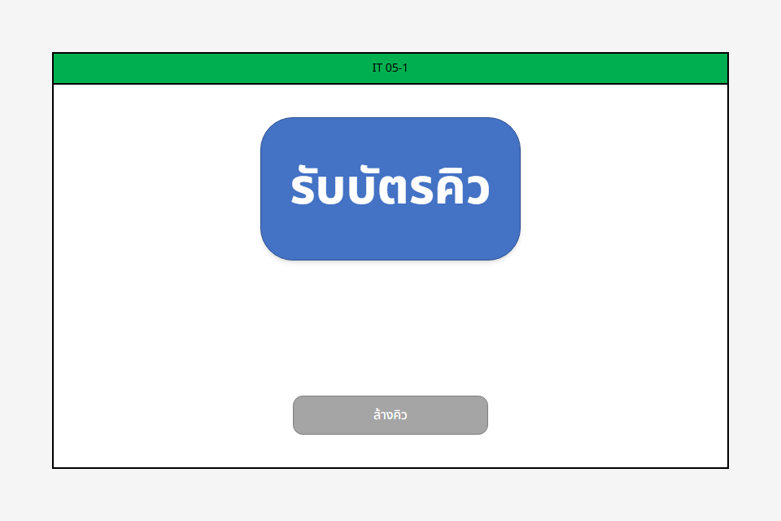
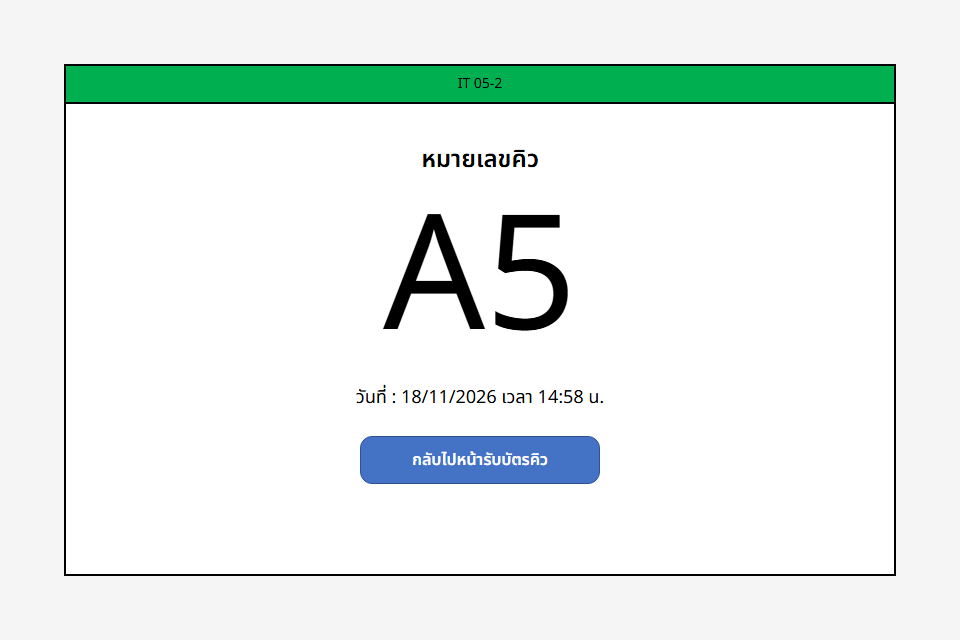
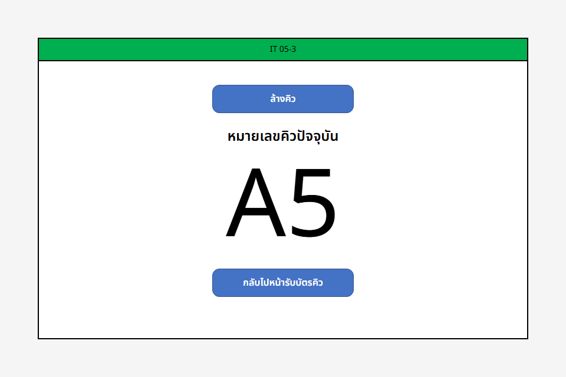
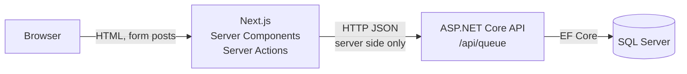
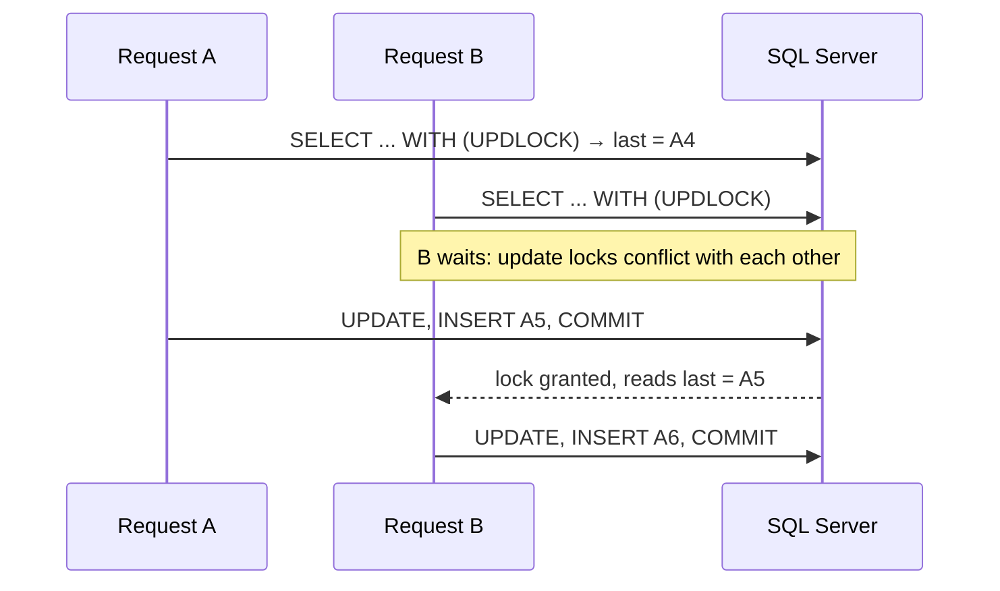

# Queue Ticket System (IT 05)

A queue-ticket kiosk: press **รับบัตรคิว** to get the next ticket (A0 → A9 → B0 → … → Z9), see the ticket with its date and time, and reset the queue back to `00`.

The key requirement is that **two people pressing at the same moment never get the same number**. This is enforced in the database with a row lock, and proven by a test that fires 100 concurrent requests and expects 100 different tickets.

**Stack:** Next.js 16 · React 19 · Tailwind CSS 4 · ASP.NET Core 10 Web API (controllers) · EF Core 10 · SQL Server 2022 · xUnit · Playwright · Docker Compose

| IT 05-1 Take a ticket | IT 05-2 Ticket number | IT 05-3 Reset the queue |
|---|---|---|
|  |  |  |

---

## Contents

- [Quick start (Docker)](#quick-start-docker)
- [Run for development](#run-for-development)
- [Tests](#tests)
- [How it works](#how-it-works)
- [Project structure](#project-structure)

---

## Quick start (Docker)

Needs only [Docker Desktop](https://www.docker.com/products/docker-desktop/).

```bash
git clone https://github.com/konlawatit/queue-ticket-system.git
cd queue-ticket-system
docker compose up --build
```

When all containers are up, open **http://localhost:8080** in your browser. The first build takes a few minutes; the database schema is created automatically.

Use the ports in the **"Open from your machine"** column. The container logs print each server's port *inside its container* (for example `web-1 | - Local: http://localhost:3000`); those addresses do not work from your browser, so ignore them.

| Service | Open from your machine | Port inside the container (shown in the logs) | Notes |
|---|---|---|---|
| Web | **http://localhost:8080** | 3000 | Next.js |
| API | **http://localhost:8081/health** | 8080 | ASP.NET Core |
| SQL Server | **`127.0.0.1,1433`** | 1433 | user `sa`, password `LocalDev_Passw0rd!` |

Docker forwards each port on your machine to the port inside its container (`docker-compose.yml`: `"127.0.0.1:8080:3000"` means *your machine 8080 → container 3000*). Ports 3000 and 5080 on your machine are left free for the development setup below, so both can run at the same time.

Stop with `Ctrl+C`. `docker compose down` keeps the data; `docker compose down -v` deletes it.

> **About the committed password.** This is a test project, not a production system. The `sa` password only protects a throwaway SQL Server container on your own machine that listens on `127.0.0.1` and holds no real data, so a working default is committed to make the project run right after cloning. A real deployment would read it from a secret store or the environment and would not use `sa`. To use your own password, see [.env.example](.env.example).

---

## Run for development

Prerequisites: [.NET SDK 10.0.100+](https://dotnet.microsoft.com/download/dotnet/10.0), [Node.js 20.9+](https://nodejs.org/) (developed on Node 26) and Docker (for SQL Server).

```bash
# 1. Database (from the repository root)
docker compose up -d db

# 2. API → http://localhost:5080, interactive API docs at http://localhost:5080/scalar
cd backend
dotnet run --project src/QueueSystem.Api

# 3. Web → http://localhost:3000 (in a second terminal)
cd frontend
npm ci
npm run dev
```

No configuration is needed: the API creates the database on first start (`Database:MigrateOnStartup` is on in Development) and the web app reads `API_BASE_URL` from [frontend/.env.development](frontend/.env.development). [QueueSystem.Api.http](backend/src/QueueSystem.Api/QueueSystem.Api.http) has ready-made requests for Visual Studio, Rider or VS Code.

Ports never clash, so all three setups can run side by side:

| | Web | API | Database |
|---|---|---|---|
| Development | 3000 | 5080 | `QueueSystem` |
| E2E tests | 3100 | 5180 | `QueueSystem_E2E` |
| Docker Compose | 8080 | 8081 | `QueueSystem` |

---

## Tests

```bash
# Unit tests (28): numbering rules and the service's use of locks and transactions
cd backend
dotnet test

# End-to-end tests (10): real browser, real API, real SQL Server
cd frontend
npx playwright install chromium   # first time only
npm run test:e2e                  # needs the database: docker compose up -d db
npx playwright show-report        # optional HTML report
```

Playwright starts the API and a production build of the web app on their own ports and database, runs the tests and stops them again.

| Level | What is checked |
|---|---|
| Unit: domain | 0 → A0, 9 → A9, 10 → B0, 259 → Z9; out-of-range numbers are rejected; after Z9 the queue is full; reset shows 00 and starts a new round from A0 |
| Unit: service | issuing and resetting read the counter **with a lock, inside a transaction**; a full queue saves nothing; the ticket id comes from the database |
| E2E: API | **100 concurrent requests → 100 × 201 and 100 different codes, A0 to J9**; A9 → B0; ticket 261 → 409, then reset → A0; unknown id → 404 |
| E2E: browser | the whole flow from the brief (IT 05-1 → 05-2 → 05-1 → 05-3 → 00 → A0), with the date shown in Thai time; A9 → B0; refreshing the ticket page does not issue another ticket; a double click issues one ticket; full queue message; unknown ticket → 404 page |

**Does the concurrency test really catch the bug?** With `WITH (UPDLOCK, ROWLOCK)` removed from the repository query, the 100-request test fails: 91 of the 100 requests did not get a ticket.
---

## How it works



The browser only talks to Next.js. Pages are rendered on the server and buttons submit **Server Actions**, which call the API from the server. So the API needs no CORS, its address (`API_BASE_URL`) never reaches the browser, and it is read at runtime, so one Docker image works anywhere.

### Ticket numbering

Each round numbers its tickets with a sequence from 0 to 259:

```csharp
letter = 'A' + sequence / 10   // 0..25 → A..Z
digit  = sequence % 10         // 0..9
```

So sequence 9 is `A9`, 10 is `B0` and 259 is `Z9`. All rules live in the domain class [QueueState](backend/src/QueueSystem.Domain/QueueState.cs) (`IssueNext`, `Reset`), which has no database code and is unit tested directly.

### Preventing duplicate tickets

If two requests read "last ticket = A4" at the same time, both would issue A5. The counter is a single row, read **with an update lock inside a transaction**:

```sql
BEGIN TRANSACTION;
SELECT * FROM QueueStates WITH (UPDLOCK, ROWLOCK) WHERE Id = 1;  -- a second request waits here
-- C#: state.IssueNext(now)
UPDATE QueueStates SET LastSequence = 5, UpdatedAt = ... WHERE Id = 1;
INSERT INTO Tickets (Round, Sequence, Code, IssuedAt) VALUES (1, 5, 'A5', ...);
COMMIT;
```



Update locks conflict with each other but not with ordinary reads, so issuers queue up one by one while the "current number" screen is never blocked. Because the second request waits before it holds any lock, and every transaction takes the same lock first, there is no deadlock. Reset takes the same lock, so it never interleaves with issuing.

Extra safety nets: a **unique index on `(Round, Sequence)`** rejects a duplicate even if the lock were bypassed, and CHECK constraints keep the numbers in range. EF Core's automatic retry is deliberately **off**: issuing a ticket is not idempotent, so if the acknowledgement of a successful commit were lost, a retry would issue a second ticket.

### Database

| Table | Columns | Rules |
|---|---|---|
| `QueueStates` (one row) | `Id`, `Round`, `LastSequence`, `UpdatedAt` | `Id = 1`; `LastSequence` −1…259 (−1 = no ticket yet, shown as `00`) |
| `Tickets` (history) | `Id` (identity), `Round`, `Sequence`, `Code`, `IssuedAt` | `Sequence` 0…259; unique `(Round, Sequence)` |

Reset increments `Round` instead of deleting rows, so every issued ticket is kept. Times are stored as UTC `datetimeoffset` and shown in Asia/Bangkok time.

### API

| Method | Path | Response |
|---|---|---|
| `POST` | `/api/queue/tickets` | `201` `{ id, code, issuedAt }` · `409` when Z9 has been issued |
| `GET` | `/api/queue/tickets/{id}` | `200` ticket · `404` |
| `GET` | `/api/queue/current` | `200` `{ "code": "A5" }` (or `"00"`) |
| `POST` | `/api/queue/reset` | `200` `{ "code": "00" }` |
| `GET` | `/health` | `200` when the API is ready |

Errors are [RFC 9457 ProblemDetails](https://www.rfc-editor.org/rfc/rfc9457); unexpected errors return 500 without a stack trace.

### Frontend details

- **Post/Redirect/Get:** taking a ticket redirects to `/ticket/{id}`, so refreshing that page only reads the ticket again.
- The button is disabled while its request is pending (`useActionState`).
- A full queue shows *"คิวเต็มแล้ว (ออกบัตรถึง Z9) กรุณาล้างคิวก่อนรับบัตรใหม่"*; an unreachable API shows an error screen with a retry button.
- Dates use the Gregorian year as in the mockup (`en-GB` format with the Asia/Bangkok time zone; `th-TH` would show the Buddhist year).
- Next.js Cache Components (on in the project template) is turned off: every screen except IT 05-1 shows live data, so there is nothing to prerender, and an unknown ticket gets a real 404 status.

---

## Project structure

```
queue-ticket-system/
├─ docker-compose.yml          SQL Server + API + web
├─ backend/
│  ├─ src/
│  │  ├─ QueueSystem.Domain/          numbering rules (no dependencies)
│  │  ├─ QueueSystem.Application/     use cases, ports, DTOs
│  │  ├─ QueueSystem.Infrastructure/  EF Core, row-locked repository, migrations
│  │  └─ QueueSystem.Api/             QueueController, ProblemDetails, OpenAPI + Scalar
│  └─ tests/QueueSystem.UnitTests/    xUnit
└─ frontend/
   ├─ src/app/                 pages IT 05-1 (/), IT 05-2 (/ticket/[id]), IT 05-3 (/reset), Server Actions
   ├─ src/components/          kiosk frame, ticket form, reset panel
   ├─ src/lib/                 API client (server only), date formatting
   └─ e2e/                     Playwright tests
```

Dependencies point inwards: `Api → Infrastructure → Application → Domain`.
